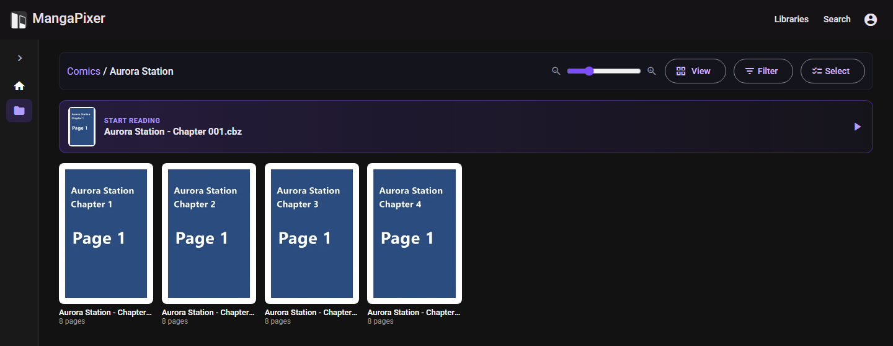

# Library layout

MangaPixer is folder-native. **Your folder tree is the library.** There is no separate metadata database to curate, nothing is renamed or reorganized, and what you see in the app mirrors what is on disk.

## How folders and archives map to the app

A library is one folder you register as an admin. Inside it:

- Every **folder** becomes a folder card you can open. Empty folders show up too; they read "This folder is empty."
- Every **supported archive** becomes a readable item. Selecting it opens the [reader](reader.md).
- Everything else (loose images, text files, PDFs) is ignored.

Names come straight from the filesystem. An archive's name is its full file name, extension included (`Chapter 001.cbz`). Embedded `ComicInfo.xml` never renames anything; it feeds the [series information](series-information.md) panel instead.

There is no special "series" or "chapter" type. By convention a series is a folder and a chapter or volume is an archive inside it, at any depth:

```text
/media/manga                      <- library root
├── Some Series/                  <- folder card ("series")
│   ├── Vol 01/                   <- nested folder
│   │   ├── Chapter 001.cbz       <- readable item ("chapter")
│   │   └── Chapter 002.cbz
│   └── Vol 02/
│       └── Chapter 003.cbz
├── Another Series/
│   ├── Chapter 001.cbr
│   └── Chapter 002.cbr
└── A One-shot.cbz                <- archives can sit at any level, including the root
```



Structure matters in two places:

- **Next/previous archive** in the reader moves between archives in the *same folder*. It does not cross into a sibling folder, so `Vol 01` does not continue into `Vol 02`.
- **Folder covers** use the first archive found anywhere below the folder, using the Name order described below, so a folder that only contains subfolders still gets a cover. To pick a folder's cover yourself, give an archive a name that sorts first. For example, `@000.cbz` sorts ahead of `Chapter 001.cbz`.

## Comics, graphic novels and BD albums

MangaPixer is built around manga, but it reads the usual naming of Western comics, graphic novels and European albums (bandes dessinées, fumetti, stripboeken) too. Nothing needs renaming; these are the names it understands, on top of the manga ones (`v03`, `Chapter 012`, `c012`):

| In a name | Read as | Example |
|---|---|---|
| `#12`, `Issue 12`, `No. 12`, `N°12` | issue 12 (counted like a chapter) | `Saga #012 (2012) (Digital).cbz` |
| `Annual 2`, `Special #1`, `One-Shot 1`, `FCBD` | an extra: shown with the issues, never counted as missing and never filling a number (like a `.5` chapter) | `Saga Annual #1.cbz` |
| `Tome 3`, `T03`, `Tomo 3`, `Band 3`, `Deel 3`, `Album 3`, `Livre 3` | album or volume 3 | `Some Series T03 - Album Title.cbz` |
| `TPB`, `HC`, `GN`, `OGN`, `Library Edition`, `Intégrale`, `Gesamtausgabe`, `Integraal` | a format word: left out of the title MangaPixer searches for | `Saga Vol. 1 TPB.cbz` |
| `(c2c)`, `(Zone-Empire)`, `(Digital)`, `(Webrip)` | a release tag: ignored, never taken for a creator | |

`No. 12` is an issue number only at the end of a name (tags in brackets aside): when a volume, chapter or other number follows it (`Monster No. 8 v01 c003`), or when the folder's own name carries it (`Robot No. 9/Robot No. 9.cbz`), it is part of the title, and so is `No. 6` at the very start of a name. The title MangaPixer searches for always keeps `No. N`. `HC` and `GN` count only in capital letters.

### Comics signs

When automatic matching looks at a folder, MangaPixer also notes, from your files alone, whether the work looks like a Western comic. Nothing is sent anywhere to work this out. The signs are:

- **Strong** (one is enough): the folder is declared **Comic** or **Graphic novel** (see [Declared facts](declared-hints.md)); a folder above it is named like a comics category (see below); the files' `ComicInfo.xml` links a [Grand Comics Database](https://www.comics.org), Comic Vine or Metron record (in `Web`, or in `Notes` as comic taggers write it, for example `[CVDB12345]` or `[Issue ID 12345]`), or the folder name carries a `[cv-12345]` / `[gcd-12345]` tag; or most files name a Western comics publisher in `ComicInfo.xml` (Marvel, DC, Image, IDW, Boom!, Dynamite, Oni Press, Fantagraphics, Top Shelf, Dargaud, Dupuis, Casterman, Le Lombard, Glénat BD, Delcourt, Soleil, Bonelli, Panini Comics, Standaard).
- **Weak** (two are needed together): most files are numbered like issues (`#12`, `Issue 12`) or like albums (`Tome 3`, `T03`); a start year right after the series name (`Saga (2012)`); a collected-format word (`TPB`, `HC`, `OGN`, `Omnibus`, `Deluxe`, `Absolute`, `Compendium`, `Intégrale`...).

Manga stays manga: many manga folders use `#12`, `Band 3` or `Omnibus` too, so one weak sign alone means nothing. A folder declared manga, manhwa, manhua, webtoon or novel has no comics signs at all; below a `Manga`, `Manhwa`, `Manhua`, `Webtoon(s)` or `Doujinshi` folder, and when `ComicInfo.xml` marks the files as manga, only a linked comics record counts. Publishers with large manga lines (Dark Horse, Drawn & Quarterly, Glénat, Panini Manga) are not on the list, and a manga imprint (`Planet Manga`, `Sakka`) cancels the publisher.

MangaPixer also notes how long the files are - a median of 48 pages or fewer looks like single issues, 100 or more like collected books - as extra evidence when it compares records, never as a sign on its own (manga chapters are short too).

A Grand Comics Database, Comic Vine or Metron link in `ComicInfo.xml` `Web` is shown as a link in the [series information](series-information.md) panel; opening it is your own visit to that site.

### Comics category folders

Like `Manga` or `Manhwa`, a folder named exactly one of these words (capitals and accents do not matter) is a category, never a series: `Comic`, `Comics`, `Comic Books`, `Graphic Novel(s)`, `BD`, `Bande(s) dessinée(s)`, `Fumetti`, `Tebeos`, `Historietas`, `Stripboeken`, `US Comics`, `European Comics`, `Eurocomics`. Some also name where the works come from, which gives a small preference to records of that origin: `BD` / `Bandes dessinées` French (Belgium included), `Tebeos` / `Historietas` Spanish, `Fumetti` Italian, `Stripboeken` Dutch, `US Comics` English-language. `Strips`, `Albums` and `Webcomics` are not category words - they are too often the names of real series.

## Supported archive formats

| Extensions | Format | Readable |
|---|---|---|
| `.cbz`, `.zip` | ZIP | Yes |
| `.cbr`, `.rar` | RAR 4 and RAR 5 | Yes, unless the archive is *solid* |
| `.cb7`, `.7z` | 7-Zip | **Not yet.** They are scanned and listed, but pages cannot be opened (see below). |

- The scanner picks files by extension, ignoring case. When a file is opened, its real format is detected from its content, so a `.cbr` that is really a ZIP still works.
- **Solid archives** (a compression mode where files can only be unpacked in sequence) cannot be read yet. The server treats every 7-Zip archive as solid, which is why `.cb7` and `.7z` do not open. Page requests for them fail with "Solid archives are not yet supported for reading." Repack them as `.cbz` to read them.
- **Password-protected archives** cannot be opened. The reader says "This archive is password-protected."
- **Not supported:** `.cbt`/tar, PDF, EPUB, and folders of loose images. A folder that only holds images appears as an empty folder.
- An archive can hold up to 50,000 entries and 32 GiB of uncompressed data.

## Pages inside an archive

- **Image formats:** `.jpg`, `.jpeg`, `.png`, `.webp`, `.avif`, `.gif`, `.bmp`, `.tif`, `.tiff` (by extension, ignoring case).
- **Ignored entries:** anything else, plus `__MACOSX/` folders, files starting with `._`, `Thumbs.db`, `.DS_Store` and `ComicInfo.xml`.
- **Folders inside the archive are fine.** Pages are ordered by their full path inside the archive, so `vol1/001.png` comes before `vol2/001.png`.
- **Page order is natural order**, described next. The order the files were stored in the archive does not matter.

## Sorting

MangaPixer sorts names in **natural order**. The same rules apply to pages inside an archive and to folders and archives in the library view.

### The rules

- Runs of digits compare as numbers: `Chapter 2` < `Chapter 10`, `page2.png` < `page10.png`.
- Equal numbers with different zero-padding put the longer padding first: `001` < `01` < `1`.
- In the library view, letters compare **without regard to case**: `apple` < `Banana` < `cherry`, and a name that differs from another only in case lists right next to it, capitalized form first (`Berserk`, then `berserk`). Page names inside an archive still compare by character code, so uppercase comes before lowercase there (`Cover.png` < `cover.png`). There is no language-specific collation.
- Punctuation such as `-`, `_` and `[` sorts before digits and letters: `[Extras]` < `10 Tigers` < `Akira`.
- Digits sort before letters: `10 Tigers` < `Akira`.
- Decimals work the way you expect for volume numbers: `Vol.1.5` < `Vol.2`.

### Pages

Page files inside an archive sort by these rules on their full path inside the archive.

### Folders and archives

In the library view, **Name** sort applies the same rules. This affects browsing, next/previous archive, folder covers, the pinned Continue row and the jump rail:

| On disk | Shown in Name order |
|---|---|
| `Chapter 1.cbz`, `Chapter 2.cbz`, `Chapter 10.cbz` | `Chapter 1`, `Chapter 2`, `Chapter 10` |
| `Chapter 001.cbz`, `Chapter 002.cbz`, `Chapter 010.cbz` | `Chapter 001`, `Chapter 002`, `Chapter 010` |

Zero-padding your numbers is no longer necessary for them to sort correctly. It is still harmless, and padded and unpadded names sort the same way, so an existing padded collection is unaffected.

With Name ascending, folders come before archives. With Name descending, the whole list is reversed, so archives come first.

### Browse sort, order and filters

The **View** button (tooltip "Change how the library is displayed") holds:

- **Card** or **List** view, plus a **Card size** slider (and, in List view, a **List columns** slider). The two sliders are saved for the browser or device you are using: a phone and a desktop can each keep their own. A device you have not set yet starts from the value you chose last somewhere else. The same two sliders are in **Settings** > **Library display**.
- **Sort by:**
  - **Name.** Natural order, as above. **Order** can be **Ascending** or **Descending**.
  - **Recently added** ("New items appear"). Newest first, by when the server first found the item, not the file's modification date. Folders are listed first.
  - **Recently read.** Your own reading activity, newest first, with folders and archives mixed. A folder counts activity anywhere below it.
  - **Recently updated** ("Folders with new content"). Folders rank by the newest archive added anywhere below them, mixed with archives. Useful for spotting series that received new chapters.

The recency sorts are always newest first and have no Order option. Your sort choice is saved to your account.

The **Filter** button holds:

- **Show:** **All**, **Reading**, **Read** or **Unread**. For folders, the filter looks at every archive below them.
- **Hide empty folders:** hides folders with no archive anywhere below them.
- **Favorites only:** shows only the folders and archives you starred.
- **Completion** (*new in 1.44.0*): **Any**, **Have it all**, **Finished, missing some**, **Everything so far**, **Missing some** or **Can't tell** - the answers of the [Completion](official-releases.md) tab. Pick one to keep only the series folders with that answer; the **Filter** button then reads **Filtered** with the answer's icon. It shows only in a folder (or library root) that holds folders linked to a series, and it works for everyone who can open the folder. While it is on, other folders and loose files are hidden, and each answer shows how many series in this folder have it, for example **Missing some (42)**. A folder whose **Track completion** is off has no answer, so it never shows. Inside a series, or in a folder without linked series, the choice does nothing.

Filters combine: for example **Unread** with **Have it all** shows the finished series you hold whole and have not started. They are not saved: they stay on while you move between folders, until you turn them off or reload the page.

### Selecting items

Choose **Select** to pick several items for a bulk action, such as marking them read, adding them to your favorites or (for admins) setting a reading direction, choosing what a folder's covers are made from (**Folder covers…**, see [Covers](covers.md#choose-what-a-folder-shows-admins)) or using the **Series** menu (see [Series information](series-information.md)): **Identify** for one item, or **Identify one by one…** for several, and **Re-run matching** (*new in 1.34.0*). In **List** view you can also tick the checkbox on any row directly, without choosing **Select** first; tapping the row itself still opens it. In the Volumes view a whole volume can be selected too, and a volume's own page has the same **Select** mode for its chapters (see [Volumes view](volumes.md#selecting-in-a-volume)). See [Read and unread](reader.md#read-and-unread) for the selection shortcuts.

### Jump navigation

A **jump rail** appears above the list (on phones, a button that opens a picker) - at the library root and inside folders (*new in 1.41.0*), in ascending and in descending order (descending reverses the rail). Each chip shows how many entries it holds; selecting it scrolls to the first one, or reloads the list from there when it is further down. The chips follow the list from top to bottom, and each one covers one unbroken stretch of it.

*New in 1.49.0:* the rail stays while a **Filter** is on (read state, hide empty folders, **Favorites only**, **Completion**) and then covers exactly the entries the filter keeps - with **Unread** on, the chips are the letters or number ranges of the unread entries, and a chip lands on the first of them. It also appears under the **Recently added** and **Recently updated** sorts as time chips (see below). Only **Recently read** has no rail. A folder with fewer than about 12 entries (after the filter) has no rail: there is nothing to jump over.

The rail adapts to what the folder holds (*new in 1.41.0*):

- **Numbers.** When most names in a folder number their chapters or volumes - `Ch. 0012`, `Vol. 003`, `Series - 045`, or just `0000` to `0321` - the rail shows round number ranges, for example `0`, `50`, `100` ... `300` for a folder of chapters 0 to 321. The step is 1, 2 or 5 times a power of ten, chosen so the rail has at most 12 ranges (fewer in a small folder); ranges with nothing in them are left out. A chip shows where its range starts, its tooltip and the phone picker show the whole range (`50-99`). A part such as `10.5` is in the range of `10`. A chapter number is used when the names state chapters, else the volume number, else the number the name starts with. A few entries without a number (a one-shot, an artbook) get an **Other** chip where they appear in the list; when the numbers do not follow the list (mixed numbering), the rail shows letters instead.
- **Letters.** Otherwise the rail shows the first character of each name, as the list sorts it:
    - `#` for names starting with a digit, a space or punctuation (brackets, quotes, dashes) - they sort before the letters.
    - `A`-`Z` for Latin letters. Accented letters such as `É` go to **Other**.
    - Script groups for other writing systems: **Kana**, **Hangul**, **CJK**, **Cyrillic**, **Greek**, **Arabic**, **Hebrew**, **Thai**.
    - **Other** for everything else.
- **Tags in brackets.** In a folder where most names open with a tag - `[Circle] Title`, `(Event) Title`, typical for doujinshi - the chips show the first letter inside that tag with its bracket, `[A` to `[Z` (and `(A` ... for round brackets), instead of one `#` chip for the whole folder. A tag that starts with a digit or a symbol is `[#`. Each chip is still one unbroken stretch of the list.
- **A common start is ignored.** When most names start the same way - `Ch. `, `Vol. `, `<Series> - `, `[Group] <Series> v` - the rail looks at what follows, so `<Series> - Alpha` and `<Series> - Beta` give `A` and `B` instead of one chip.
- **Folders and files.** When a folder holds both subfolders and archives (folders are listed first), the kind with more entries gets the rail and the other one a single **Folders** or **Files** chip at its place in the list. *New in 1.49.0:* once the smaller kind has 20 or more entries it gets its own letters or numbers too, and the rail labels each kind (**Folders**, **Files**) before its chips.
- **Time chips.** Under **Recently added** and **Recently updated** the chips are **Today**, **This week** (since Monday), **This month**, **This year**, then one chip per older year, newest first, each with its count (*new in 1.49.0*). Today and the week follow your own clock and time zone. Under **Recently added**, where folders are listed before files, each kind has its own time chips. Under **Recently updated**, a folder with nothing inside yet is last, under **Other**. When every entry falls in the same period there is no rail. Selecting a chip lands on its first entry; scrolling up from there is not available under these sorts (select an earlier chip, such as **Today**, to go back).

The rail is not shown in the [Volumes view](volumes.md), which lists volumes instead of files, or when it would have a single chip.

#### Scrubbing a long list on a phone

*New in 1.49.0.* On a phone, a folder or library with **50 or more entries** also shows a thin strip on the right edge of the screen, with the rail's chips drawn small along it (every few chips when there are too many to fit). Put a finger on the strip and slide it up or down: a bubble beside your finger names the chip you are on and how many entries it holds, and the list does not move. Lift your finger to jump there - the same jump as choosing that chip in the picker. A single tap on the strip jumps to the chip you tapped. If the screen is taken over mid-drag (a call, a swipe from the edge) nothing is jumped to. The strip's touch area is about 44 px wide, so a tap on the far right edge of a card goes to the strip instead.

The picker button stays on every level, short or long: it shows where you are, and it is the way to jump with a screen reader or without a touchscreen (the strip is touch only and is hidden from screen readers). Folders with fewer than 50 entries show the picker button alone; on tablets and computers the rail is unchanged.

## Favorites

Star any folder or archive to keep it within easy reach. The star appears on cards and rows in the library view, on search results, on the home page's **Continue reading**, **New chapters** and **Favorites** cards (bottom-right of the cover; on a New chapters card it stars the folder, or the archive for a loose archive), and in the reader toolbar (for the archive you are reading).

*New in 1.48.0:* inside a folder, a star sits in the top bar right after **Info** and stars the folder you are viewing - handy for a series you open from a link or from search. It is not shown at the top of a library, which is not a folder. It is filled while the folder is a favorite, and the folder then appears on the **Favorites** page like any starred folder.

- **Favorites** in the sidebar, above your libraries, lists everything you starred, most recently starred first.
- **Favorites only** in the **Filter** menu narrows any library view to your starred items.
- Two options in **Settings** > **Favorites**, both off by default: a **Favorites** row on the home page, and highlighting starred results in search (a star badge, and they move to the top - *from 1.49.0* of the whole result list, not only of each page; a close match for a typo still comes after every exact hit).

When you star two or more archives in the same folder, the Favorites page and the home **Favorites** row show them as one stacked card: the folder's cover and name, and how many favorites it holds. The stack sits where your most recently starred archive of that folder would be. Selecting it opens the folder with **Favorites only** turned on, so you see just the archives you starred there; turn the filter off to see the whole folder. Only archives stack, and only with the folder they are directly in: a starred folder always keeps its own card.

Favorites show your reading state like the library view does: an archive card carries **Read** or **Reading**, and a folder card - and a stack - carries **Read** (every archive in the folder is read) or **Reading** (some are read or in progress), shown at the top right of the cover. A stack counts the **whole folder**, not only the archives you starred in it. The marks are your own: another user of the same server sees theirs. The same badges appear on the home page's **Favorites** row, whose cards also carry the (i) and the summary on hover when there is series information, and a star - turning it off takes the card out of the row.

Favorites belong to your account and follow you to every device. They respect Private libraries: while Incognito is on, favorites in your Private libraries are hidden too.

## Search

The search icon in the top bar opens **Search**. It looks through the names of the folders and archives in the libraries you can see (Private libraries stay out while Incognito is on).

*New in 1.49.0:*

- **Words in any order.** Every word you type must be in the name, in any order: `piece one` finds `One Piece`. Upper and lower case, accents and punctuation do not matter: `pokemon` finds `Pokémon Adventures`, `re zero` finds `Re:Zero`. Put words in double quotes to keep them together and in that order: `"one piece" color`.
- **Names, not paths.** A folder or archive is found by its own name, whether it is linked to series information or not. An archive that would match only because of the folder it sits in is not listed one by one: the folder's card says how many it holds, for example **+41 inside**. A sub-folder whose own name matches gets its own card.
- **Best matches first.** An exact name comes first, then names that start with what you typed, then names with a word that starts with each word, then names that merely contain it; folders before archives, then by name. The line above the results counts them by kind, for example **1 folder, 65 archives**. The **Series matches** row (alternative titles) is ordered the same way.
- **Typos.** When few names match exactly (fewer than 10), up to 50 close matches follow the exact ones, and the page says **Showing close matches for ...**. A word needs at least 4 letters to be matched with a typo: one wrong, missing, extra or swapped letter in words of 4 to 7 letters, two from 8 letters. Words of 3 letters or fewer, and words in quotes, must be typed as they are.
- **One or two letters.** A search of only one or two letters lists the names with a word that starts with them (`ak` finds `Akira` and `Domu: Akira`), and says so.
- **Favorites first** when you turned on highlighting starred results in **Settings** > **Favorites**.

*New in 1.50.0:*

- **Leave words out.** A word with a `-` in front must not be in the name: `berserk -deluxe` lists `Berserk` but not `Berserk Deluxe`. Put words in quotes to leave out only that phrase (`-"black swordsman"`); a `-word` with punctuation inside is one phrase too (`-re:zero`). A folder whose name holds the word is left out with everything inside it, and a folder's **+N inside** count does not count the archives the word names. A `-` inside a name still separates words as before (`spider-man` finds `Spider-Man`), and so does a `-` with a space after it. A search of only `-` words finds nothing - type at least one word to look for.
- **Words spread over folders.** The words may be split between an archive's or folder's own name and the names of the folders it sits in: `berserk 12` finds `Berserk/Vol 12.cbz`, and `berserk 6` finds `Berserk/Volumes/Ch. 0106.00 Vol. 006.cbz` - handy when your files are named without the series title (as MangaList names chapters and volumes). At least one word must be in the item's own name, so `berserk` alone still lists the `Berserk` folder (with **+N inside**), not every volume in it. Names that hold every word themselves come first, then these. Only folders in the same library count, and only libraries you can see.
- **Numbers.** A number of one or two digits also finds the same number with zeros in front: `6` finds `Vol. 006` and `12` finds `Ch. 0012` (zeros you type still count: `01` does not find `Vol 1`).
- **Series matches** also find a title with a typo (after the exact titles, when the page shows close matches) and from one or two letters (a word of the title that starts with them).

### Quick results while you type

*New in 1.49.0.* On a desktop or tablet the top bar has a **search box** (press `/` anywhere on a page to jump into it). On a phone the top bar stays as it is, and the **Search** page shows the same results under its field while you type.

- After a short pause in your typing, a list opens with the best few of each kind - **Series** (found by title or other title; the folder or archive linked to the series opens), **Folders**, **Archives**, **Creators** and **Tags** (tags and genres, with how many works carry each). Archives show the folder they sit in. Names are matched as in the search above (words in any order, accents and case ignored; a name needs a word of 3 letters or more, and quick results do not look for typos - the full search does). Creators and tags need 2 letters.
- **Keyboard:** **Up** and **Down** move through the list, **Enter** opens the one you chose, **Enter** with none chosen opens the full **Search** page with what you typed, **Escape** closes the list (a second **Escape** clears the box).
- **Mouse or touch:** a result opens when you select it. A folder opens in the library, an archive in the reader, a creator or tag opens the [tag view](series-information.md) of its works.
- *New in 1.50.0:* quick results follow the `-word` and the words-over-folders rules above (`berserk 12` lists `Vol 12` of the `Berserk` folder), and look for typos in a single word of 5 letters or more - series titles and folder names, after the exact matches (two words, a shorter word or an archive name: the full **Search** page).
- **Typed fields:** while the text ends in a field - `creator:ura`, `tag:`, `genre:`, `publisher:`, `magazine:`, `type:`, `year:`, `series:`, `library:` or `is:` - the list shows the values of that field instead (a creator or tag with its work count, a library by name). Choosing one completes the field, for example `creator:"Naoki Urasawa"`, and you can type on.
- Only what you may open is listed: the libraries you can see (Private libraries stay out while Incognito is on), and no series, creators or tags from a library that shows no series information.

The search updates the first time MangaPixer 1.49.0 starts: it rebuilds its search index once (a few seconds for a large library) before the server opens.

Search results show your read marks and can be filtered by **Reading** / **Read** / **Unread**; tags and the `creator:` / `genre:` ... syntax are described in [Series information](series-information.md).

## Rescans, moves and deletions

**Each library is rescanned automatically on a schedule, daily by default.** There is no file watcher. An app holding an [API token](api-tokens.md#request-a-library-scan) allowed to request library scans - for example MangaList after it files new downloads - can also start a scan of a whole library (*new in 1.36.0*). In **MangaPixer Administration** > **Libraries**:

- **Auto-scan** sets how often a library is rescanned: **Off**, **Hourly**, **Every 6 hours**, **Daily** (the default) or **Weekly**. It is set in the library's row of **Scheduled jobs**; under each library's row on the **Libraries** card a line shows the schedule with a **Change in Scheduled jobs** link. Next to it, **Last scan** shows when the library was last scanned and **Next scan (approx.)** when the next automatic scan is expected. The library's line on the **Libraries** card also says who started the last scan: **by schedule**, **by admin** with the admin's name, or **by token** with the API token's name (a token or account removed since then shows as "a removed token" / "a removed admin"). Only admins see this. See [Automatic scans](#automatic-scans).
- **Scan now** (the circular-arrow icon) on a library's row scans that library.
- **Scan all libraries** scans every library. Libraries that are already scanning are skipped.
- While a library scans, its row shows it: a spinning ring around its icon, a thin moving line along the bottom of the row, and **Scanning…** with **Cancel scan** in its line - **Cancel scan** stops the scan. The icons on the right stay where they are; **Scan now** is greyed out until the scan ends (*changed in 1.44.0*). *Changed in 1.45.0:* the whole library - its row and its **Auto-scan** and **Declared** lines - is tinted, with the moving line under all of them, and the rings and lines of several scanning libraries move together. While more than one library scans, a line above the list says how many (for example **3 libraries scanning · Cancel all**); **Cancel all** stops every one of them.
- The palette icon opens an **icon picker** so you can give a library a distinct glyph instead of a name-derived default badge.

After a scan, new archives are analyzed in the background. Their page counts and covers fill in over the next moments.

### Automatic scans

- A library is due once its interval has passed since its **last completed scan**, whether you started that scan or the schedule did. So **Scan now** also pushes the next automatic scan back. A library that has never been scanned is due straight away, so a newly registered library is scanned within a few minutes unless you set it to **Off** first.
- Nothing is scanned in the first 3 minutes after the server starts. After that, the server checks every minute and scans due libraries **one at a time**. It waits while any scan is running, including one you started.
- A library whose folder is unreachable (for example an unmounted share) is skipped until the folder is back. The log records this once, not every minute. If an automatic scan fails, it is retried after an hour at the earliest (or after one interval, for hourly scans).
- **Next scan (approx.)** is an estimate: the scan starts at the first check after that time, and later if another scan is running. "shortly" means the library is already due.
- To switch automatic scans off for the whole server, set `MangaPixer:Scanning:Scheduler:Enabled` to `false` (see [Configuration](configuration.md#scanning)). Each library's setting is kept.

**What a rescan does:**

- **New files and folders** are added.
- **Changed files** (different size or modification time) are re-analyzed and get a new cover. Reading progress is kept.
- **Deleted files and folders** disappear from the library once the scan completes. If a file comes back at the same path, it reappears with its progress intact. *New in 1.31.0:* they go to the [trash](trash.md), where their reading state is kept for the retention time (Monthly by default) before an admin, or automatic cleaning, empties it.
- **Moved or renamed archives** keep their identity: reading progress, read marks, bookmarks and thumbnail follow the file to its new location, also in **another library** (see [Moving series between libraries](#moving-series-between-libraries)). MangaPixer recognizes a moved file by a content signature: its size plus a hash of its first and last 64 KiB. A move is recognized only when:
  - the archive had been analyzed before it moved (*1.31.1:* archives analyzed by versions before 1.5.0 get their signature from a slow background pass after the update - until it has reached them, a move of those is not recognized),
  - exactly one removed file matches exactly one new file, and
  - the new file is not still being written.

  Otherwise the moved file is treated as a new item. A file that was removed and comes back later at another path is recognized the same way while it is inside the move window (below).
- **Chapters replaced by their volume** (*new in 1.40.0*): when the chapter files of a series are replaced, in the same folder, by the volume file that collects them (as some download and library tools do), the volume keeps what you had read. It counts as **read** when you had read every chapter the series' volume list gives for that volume - extras such as a chapter 9.5 are optional - and as **in progress** at its first page when you had read only some of them. This needs a folder linked to its series (Confirmed or automatic) with a stored volume list (see [Volumes](volumes.md#how-chapters-are-placed-in-a-volume)); the volume file must be named as a volume (`v01`, `Vol. 1`). It happens once the volume file has been analyzed - on the next scan, or when the server starts - while the removed chapters are still in the [trash](trash.md) (the move window, below). A volume someone has already marked read or read past its first page is left as it is, a volume you mark unread afterwards stays unread, and a volume file that was in the folder at the same time as the chapters is not a replacement.
- **Volume ranges and re-released volumes** (*new in 1.41.0*): the same works for a file that holds several volumes, named as a volume range (`v01-03`, `Vol. 1-3`, `Volume 01-05`) - it counts as **read** when you had read every chapter of every volume in the range, and as **in progress** at its first page when you had read some of them. Each volume of the range can also be covered by the volume file it replaced (`v01`, `v02` and `v03` replaced by `v01-03`). If the series' volume list does not give one of the range's volumes exactly (and no volume file of it was replaced), the range is left as it is. A volume file that replaces the same volume (a re-encoded or re-released `v03` replacing `v03`) takes what you had done with the old one, even in a folder that is not linked to a series: **read** stays read, and a volume you were reading continues at the same page when both files have the same number of pages (otherwise at the first page). Of two replaced copies of a volume, the one you read most recently counts. The two file names must name the same work and edition once volume numbers, bracketed tags (such as the scan group or `(Digital)`), years and the extension are left out - so another series' `v03` in the same folder, or a kanzenban `v03` replacing a regular one, is not a replacement. Two files in the folder that hold the same volume (`v01-03` next to `v03`) are left as they are, a file with exactly the same content is a move (above), not a replacement, and nothing is carried in a folder marked **Don't match**, **Collection about** or an artist's folder.
- **Moved or renamed folders** keep the settings an admin gave them (reading direction, series link or **Don't match**, source precedence, **Content**, the Volumes view setting, the cover choice and the folder's [cover preference](covers.md#choose-what-a-folder-shows-admins)) and every user's star when at least 80% of their archives moved to the same new folder. Otherwise the settings wait under **Missing folders** on the Metadata Manager page. See [Renamed and moved folders](series-information.md#renamed-and-moved-folders).
- **Safety net:** if a scan finds that almost everything has vanished (for example an unmounted share), it deletes nothing. The same applies if the library folder itself is unreachable; the scan fails with "Library root is not accessible."

### Moving series between libraries

You can move a series folder (or single archives) from one library's folder to another's on disk, for example from "Ongoing" to "Concluded". Reading progress, read marks, bookmarks, favorites and reader settings move with it, together with the folder's series link and admin settings. This works whichever library is scanned first:

- **The old library is scanned first.** The scan removes the series from the old library. When the new library is scanned, MangaPixer recognizes the files and moves the existing items: nothing is analyzed again, covers and thumbnails stay, and a **Confirmed** series link stays confirmed (no new automatic match).
- **The new library is scanned first.** The new library first shows the series as new items. When the old library is scanned and the new items have been analyzed, MangaPixer pairs each removed archive with its new copy. Besides the content signature, both copies must list the same pages (entry names and sizes). It then copies each user's state to the new copy wherever the new copy has none. A series link that the automatic matching set on the new folder to the same series becomes **Confirmed**. The new copies keep their original **Added** date, so a moved series does not show up as new chapters.
  - If someone already read the new copy and their position differs from the old one, or the new folder got a different series link, nothing is overwritten. These cases wait on the **Move conflicts** page (in **MangaPixer Administration**), where an admin chooses for each one, for a selection or for all: **Use old** puts the state from before the move on the new copy, **Keep new** leaves the new copy as it is. Read marks, bookmarks and favorites never conflict: the new copy gets those it does not have yet.

Good to know:

- **The move window.** A removed item can be recognized at its new place for as long as the trash keeps it: the trash retention setting (**Daily**, **Weekly**, **Monthly**, **Quarterly** or **Yearly**; **Monthly**, 30 days, by default). After that, a file that reappears is a new item.
- **Access.** State moves even for users who cannot open the new library right now. They see it again as soon as an admin gives them access. Nothing becomes visible to anyone who could not see it before.
- **Copies stay separate.** Two identical files that were both in your libraries at the same time are never merged. If one series was copied to two places, neither copy takes the state over automatically.
- Old links to the removed items (a bookmarked browser address, for example) do not redirect to the new copies.

**What is skipped during a scan:**

- Folders whose names start with `.`.
- System and tool folders: `@eaDir`, `#recycle`, `$RECYCLE.BIN`, `System Volume Information`, `.git`, `.svn`, `.hg`, `.yacreader`, and similar.
- Files named `Thumbs.db`, `desktop.ini`, `.DS_Store`, `ComicInfo.xml`, `YACReader.ini` and `YACReaderLibrary.ini`.
- Symbolic links to folders are not followed.

## Read-only guarantee

The server never modifies, moves, renames, deletes or writes into anything inside your library folders:

- The server's file-system layer has no write operations, and it opens every source file read-only.
- Everything MangaPixer generates goes to its own storage roots instead:
  - extracted page images go to the cache (`/cache`),
  - temporary unpacking goes to scratch (`/scratch`),
  - cover thumbnails go to `/data/thumbnails`.
- The installation guides mount media with `:ro`, so the operating system enforces this as well.
- **Remove library** in the admin page deletes only MangaPixer's records and reading progress for that library. Your files are not touched.

## Thumbnails

Covers are generated from the first page of each archive, 400 px on the long edge, stored as WebP in `/data/thumbnails`. They survive restarts and cache clears. The server creates them:

- after an archive is analyzed,
- after each scan,
- in a background pass at every start-up that fills in any that are missing,
- and when you select **Regenerate thumbnails** (the image icon) on a library's row in the admin page.

If covers are missing, see [Troubleshooting](troubleshooting.md#thumbnails-are-missing).
